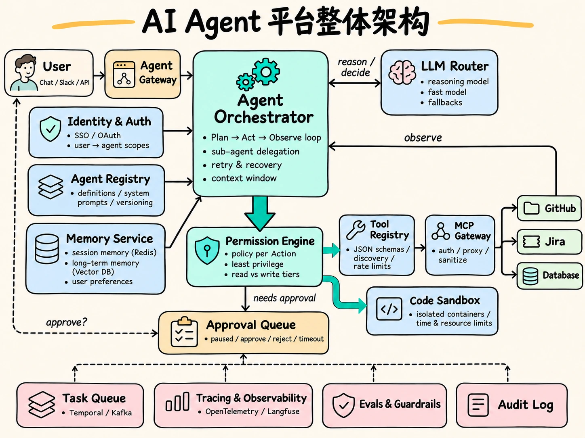
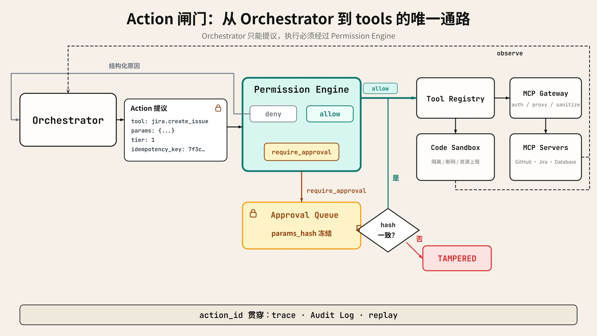
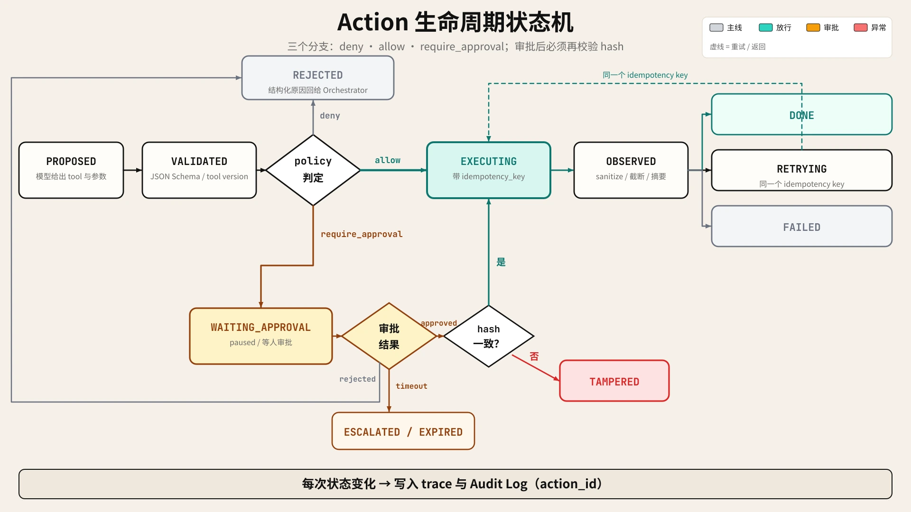
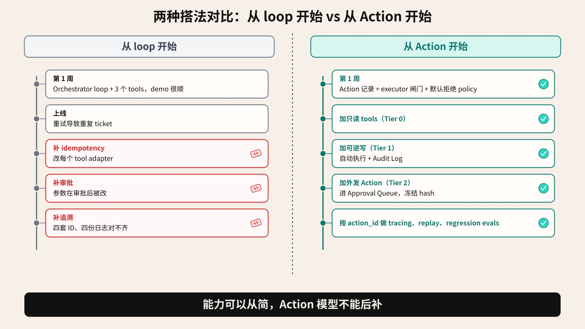

这半年我一直在做 AI Agent 开发，踩过不少坑，也把各路大拿的分享和各家官方技术文档反复对照着读了一遍。把这些实践和资料放在一起，我梳理出了自己理解的 AI Agent 平台整体架构，画成了下面这张图。

User 从 Chat、Slack 或 API 进来，经过 Agent Gateway，进到正中间的 Agent Orchestrator；周围是 LLM Router、Memory Service、Tool Registry、MCP Gateway，中间压着 Permission Engine 和 Approval Queue，底下一排是 Task Queue、Tracing & Observability、Evals & Guardrails 和 Audit Log Store。图里出现的具体技术（Redis、Vector DB、Temporal、OpenTelemetry、Langfuse 等）只是示意，换成同类组件也成立。



下面分两步讲：先拿一个请求，从头到尾走一遍这张图，把每个子系统的职责和边界说清楚；然后再讲我的判断：**这张图里最值钱的是一根很不起眼的箭头，它说明 Agent 平台的核心对象是 Action，Orchestrator 只是 Action 的提议者。** 搭平台的顺序也该照这个来：先设计 Action，再写 Orchestrator。

## 先走一遍：一个请求在 Agent 平台里的完整路径

为了不讲空话，假设一个典型的内部场景（这是为了说明而设的例子，不是某个真实案例）：

> 用户在 Slack 里说：“把这周新增的 P1 bug 汇总一下，在 Jira 建一张跟进 ticket，并通知各模块 owner。”

这一句话里有读（查 bug）、有可逆的写（建 ticket）、有外发（通知别人）。下面是它在这张架构图里的路径：

```text {lineNos=false}
User (Chat / Slack / API)
  │
  ▼
Agent Gateway ──► Identity & Auth
  │
  ▼
Orchestrator ◄──► LLM Router
  │    ▲         (reasoning / fast / fallback)
  │    │
  │    └── observe: results flow back ──────┐
  ▼                                         │
Permission Engine ──► Approval Queue        │
  │       (needs approval ──► User)         │
  ▼                                         │
Tool Registry ──► MCP Gateway               │
  │       └──► GitHub / Jira / DB ──────────┤
  ▼                                         │
Code Sandbox ───────────────────────────────┘

Cross-cutting layers:
  · Memory Service
  · Task Queue
  · Tracing & Observability
  · Evals & Guardrails
  · Audit Log
```

右侧那条竖线就是 observe：tool 和 sandbox 的结果都回到 Orchestrator，进入下一轮 plan。Identity & Auth 确定谁在发请求、Agent 能代表谁做事；需要审批的 Action 在 Approval Queue 等 User 拍板。最下面五个是横切层，贯穿整条链路。


### 1. 入口：Agent Gateway 与 Identity & Auth

**Agent Gateway** 是统一入口。Slack 消息、Web 聊天、API 调用在这里变成同一种内部请求，做限流、会话路由和协议适配。它不该做任何业务判断。

**Identity & Auth** 回答两个问题：发请求的人是谁（SSO / OAuth），这个 Agent 可以代表他做到什么程度（图上写的 User → agent scopes）。之后链路上的每一次权限判定，都以这里确定的身份为主体。一个常见错误是让 Agent 用一个共享的高权限服务账号干所有事，这样后面再细的 policy 也只能管住“Agent 能做什么”，管不住“替谁做”。

### 2. 决策：Orchestrator、Agent Registry 与 LLM Router

**Orchestrator**（编排层）是 Agent 运行的控制中心，图上写了四件事：Plan → Act → Observe loop、sub-agent delegation、retry & error recovery、context window management。拿到请求后，它先从 **Agent Registry** 取出这个 Agent 的定义：system prompt、可用 tools 列表、版本号。然后拼装上下文，问模型下一步做什么。

在我们的例子里，第一轮 plan 大概是：查 Jira 里本周新增的 P1 → 按模块分组 → 建一张汇总 ticket → 给每个 owner 发通知。

**LLM Router** 决定这一步问哪个模型：复杂规划交给 reasoning model，分组、摘要这类轻活交给 fast model，主模型不可用时走 fallback。fallback 有个容易忽略的点：不同模型的 tool calling 格式和 JSON 稳定性不一样，换模型之前要确认它能正确产出这个 Agent 用到的 tool schema，光改个模型名是不够的。

Orchestrator 管状态、预算、上下文和恢复，模型只负责推理和决策。模型可以换，执行语义得稳定。

### 3. 闸门：Permission Engine 与 Approval Queue

模型给出“调用 `jira.search`，参数如下”之后，Orchestrator 不会直接去调。请求先到 **Permission Engine**（权限引擎）：图上写的是 policy check per action、least-privilege scopes、read vs write tiers。查 bug 是只读，放行；建 ticket 是可逆的写，放行但记审计；通知 owner 属于外发，标记为 needs approval。

需要审批的请求进入 **Approval Queue**：任务挂起，等人 approve 或 reject，超时就 escalate。图上从这里有一根虚线回到 User，旁边写着“approve?”。

### 4. 执行：Tool Registry、MCP Gateway 与 Code Sandbox

放行的调用经过 **Tool Registry**（tools 的 JSON schema、发现与检索、每个 tool 的 rate limit）找到具体实现，再走 **MCP Gateway** 到后面的 MCP Servers（图上画的是 GitHub、Jira、Database）。MCP Gateway 负责对 MCP server 的认证、代理 tool call、清洗响应。需要跑代码的，比如把 bug 列表做个统计图，进 **Code Sandbox**：隔离的容器，有时间和资源上限。

执行结果回到 Orchestrator，就是 loop 里的 observe。Orchestrator 把结果摘要放进上下文，进入下一轮 plan，直到任务完成、失败或被取消。

### 5. 横切层：Memory、Task Queue、tracing、evals、Audit Log

主路径之外，图底部和左侧还有一组横切的子系统：

- **Memory Service**：session memory（图上写 Redis）放当前对话状态，long-term memory（Vector DB）放跨会话的知识，再加 user preferences。它为 Orchestrator 拼上下文提供素材，但不该决定什么能执行。
- **Task Queue**（Kafka / Temporal）：long-running jobs 和 durable workflows。审批可能要等一个周末，任务不能因为进程重启就丢。
- **Tracing & Observability**（OpenTelemetry / Langfuse）：every step & tool call、token cost、replay runs。
- **Evals & Guardrails**：output checks、prompt-injection defense、regression evals。
- **Audit Log Store**：只追加的审计记录，回答事后“谁在什么时候做了什么”。

把整张图压成一张表，大致是这样：

| 组件 | 职责 | 边界：它不该做什么 |
|---|---|---|
| 入口 · Agent Gateway | 多渠道统一接入、限流、会话路由 | 不做业务和权限判断 |
| 入口 · Identity & Auth | 确定用户身份和 user → agent scopes | 不发放共享的高权限凭证 |
| 决策 · Orchestrator | Plan → Act → Observe、预算、重试、上下文管理 | 不直接调用 tools |
| 决策 · Agent Registry | Agent 定义、system prompt、版本 | 不在运行时被模型修改 |
| 决策 · LLM Router | 按难度、延迟、成本选模型，fallback | 不忽略 tool calling 格式兼容 |
| 闸门 · Permission Engine | 每个 Action 的 policy 判定 | 不把判定交给模型 |
| 闸门 · Approval Queue | 高风险 Action 挂起、人工审批、超时升级 | 不允许批准后参数再变 |
| 执行 · Tool Registry | tool schema、版本、发现、限流 | 不提供“万能 tool” |
| 执行 · MCP Gateway | MCP 认证、代理、响应清洗 | 不把 token 交给模型或下游透传 |
| 执行 · Code Sandbox | 隔离执行不可信代码 | 默认不开放网络和宿主文件系统 |
| 横切 · Memory Service | session / long-term memory、偏好 | 不跨租户召回 |
| 横切 · Task Queue | 长任务、durable workflow | 不靠内存保存审批状态 |
| 横切 · Tracing / Evals / Audit | 全链路追踪、回归评测、审计 | 不在日志里留密钥和敏感原文 |

图右上角列的五项 Core Capabilities（multi-step planning、tool & MCP integration、short + long-term memory、human-in-the-loop approvals、full trace & replay），和这张表是一一对得上的。

## 那根往下的箭头：Action 是一等公民

走完一遍，回头再看图。大多数人的目光会落在中间最大的 Orchestrator 上。我觉得最值钱的是从 Orchestrator 往下、指向 Permission Engine 的那根箭头。**Orchestrator 和 tools 之间没有直连线。** 它想调 GitHub、Jira、数据库，想进 Code Sandbox，都得先往下走一趟 Permission Engine，需要时再拐进 Approval Queue，回来时带着 observe 的结果。



这根箭头说的是一件很多团队要到出事后才想明白的事：平台里流转的核心对象是 **Action**（Agent 提议执行的一次具体操作），Orchestrator 只负责提议。

为什么这么说？看看常见的搭法。拿一个框架，写一个 loop：模型给 plan，调 tool，把结果塞回上下文，再问下一步。接三五个 tools，跑十几个用例，效果好得让人想立刻上线。这个阶段有一个隐含前提：**每次 tool call 都是一次性的、无副作用的、由开发者本人盯着的。** demo 里三条都成立，上线后会一条条失效：

- **重试。** tool 超时，loop 按设计重试一次。可第一次调用其实成功了，只是响应没回来。于是 Jira 上多了一张一模一样的 ticket，owner 收到两条一样的通知。
- **审批。** 产品要求外发前要人确认，于是加了个确认弹窗。用户点了同意，模型在执行前“顺手”改了收件人，因为上下文里刚读到一段 bug 描述写着“请同步给某某”。
- **追溯。** 安全同事问：上周三那次数据库写入，是哪个用户、哪个 Agent 版本、在哪条 policy 下、谁批准的？你翻日志，只看到一段模型输出和一行 200 OK。

换模型解决不了这三个问题，加 prompt 也解决不了。它们出在同一个地方：系统里没有一个叫 Action 的东西，只有“模型说了一句话，然后代码照着做了”。

OWASP 在 [LLM06:2025 Excessive Agency](https://genai.owasp.org/llmrisk/llm062025-excessive-agency/) 里把这类风险的根因归成三条：excessive functionality、excessive permissions、excessive autonomy。它给的缓解措施里有一条我认为最关键，叫 complete mediation：授权应该在下游系统里做，不能交给模型判断，所有经由扩展发往下游的请求都要按安全 policy 校验。要做到“所有请求都校验”，先得让每个请求都是一个能被校验的对象。

所以我的建议是：写 Orchestrator 之前，先定义 Action 记录。它不必复杂，但从第一天起就该是平台里最核心的表。

```python
from dataclasses import dataclass, field
from enum import Enum
import hashlib, json, uuid

class Tier(Enum):
    READ = 0          # 只读、低敏感：直接执行
    REVERSIBLE = 1    # 可逆写：自动执行，必须审计
    EXTERNAL = 2      # 外发、生产变更、批量修改：需要审批
    CRITICAL = 3      # 删除、资金、权限变更：强审批或禁止

@dataclass(frozen=True)
class Action:
    action_id: str
    run_id: str               # 属于哪次 Agent 运行
    tenant_id: str
    principal: str            # 代表谁在做：用户 / sub-agent / 服务账号
    agent_version: str        # Agent 定义 + system prompt 版本
    tool: str                 # 例如 "jira.create_issue"
    tool_version: str         # tool schema 版本，防止定义被悄悄换掉
    params: dict              # 模型提议的参数，校验后冻结
    tier: Tier
    idempotency_key: str = field(
        default_factory=lambda: str(uuid.uuid4())
    )

    @property
    def params_hash(self) -> str:
        canonical = json.dumps(
            self.params, sort_keys=True, ensure_ascii=False
        )
        return hashlib.sha256(canonical.encode()).hexdigest()
```

注意 `frozen=True`。一个 Action 一旦被提议并通过参数校验，它就不再属于模型了。模型可以提议新的 Action，但不能修改已经进入审批或执行流程的旧 Action。

有了这个对象，上一章表格里那几个看起来像“治理附件”的组件，就成了同一个对象的四个视角：

| 组件 | 它对 Action 做什么 | 回答的问题 |
|---|---|---|
| Permission Engine | 按 `principal / tool / tier / params` 判定 allow、deny 或 require_approval | 能不能做 |
| Approval Queue | 冻结 `params_hash`，挂起等人，超时升级 | 高风险时谁拍板 |
| Task Queue / durable workflow | 按 `idempotency_key` 执行和重试，记录 checkpoint | 做了几次、做到哪了 |
| Tracing + Audit Log | 以 `action_id` 串起模型调用、policy 判定、审批、tool 结果 | 事后说得清吗 |

所以我说它们决定了平台的数据模型。权限、审批、幂等、tracing 如果各自后补，你会得到四套 ID、四份日志、四种“这次调用”的定义。等到要回答“上周三那次写入是谁批的”，就得手工把四个系统对齐。

接下来按主路径的顺序，逐个子系统往下拆。

## Orchestrator：只产出 Action 提议

Orchestrator 的 loop 仍然需要，只是它每一轮的产出变成了一个或几个 Action 提议，执行交给另一条路径。一个 Action 的生命周期是这样的：

```text {lineNos=false}
PROPOSED          模型给出 tool 名和参数
  → VALIDATED     JSON Schema 校验、tool 版本匹配
  → POLICY_CHECKED
      ├─ deny             → REJECTED（结构化原因回给 Orchestrator，让它改 plan）
      ├─ allow            → EXECUTING
      └─ require_approval → WAITING_APPROVAL
                              ├─ approved (hash ok)  → EXECUTING
                              ├─ rejected            → REJECTED
                              └─ timeout             → ESCALATED | EXPIRED
  → EXECUTING     带 idempotency_key 调用 tool / sandbox
  → OBSERVED      结果清洗、截断、摘要后回到上下文
  → DONE | RETRYING | FAILED
```



落到 Action executor 里，大致是这样一段伪代码：

```python
async def execute(action: Action, ctx: RunContext) -> Observation:
    validate_schema(action.tool, action.tool_version,
                    action.params)

    decision = policy.evaluate(action, ctx)   # 不问模型，问 policy
    trace.event("policy", action_id=action.action_id,
                decision=decision)

    if decision.kind == "deny":
        return Observation.rejected(decision.reason)

    if decision.kind == "require_approval":
        # 持久化挂起，可等几小时
        approval = await approvals.wait(
            action_id=action.action_id,
            params_hash=action.params_hash,
            timeout=decision.timeout,
        )
        if not approval.ok:
            return Observation.rejected(approval.reason)
        if approval.params_hash != action.params_hash:
            # 批准的和要执行的不是同一个
            raise TamperedAction(action.action_id)

    result = await tools.call(
        action.tool, action.params,
        # 重试不重复建单、不重复发信
        idempotency_key=action.idempotency_key,
        credentials=vault.for_principal(
            action.principal, action.tool
        ),
    )
    audit.append(action, decision, result.summary)  # 只追加
    return sanitize(result)
```

Orchestrator 自己这一侧，要守住几条硬约束：

- **硬上限：** 最大步数、最大 tool call 次数、token 和费用预算、墙钟超时，以及可随时取消。没有上限的 loop，烧起 token 来非常稳定。
- **错误分类：** 模型输出格式错误就重新生成；tool 超时和限流就退避重试（同一个 idempotency key）；权限被拒就把结构化原因回给模型改 plan；业务失败交给人。
- **Checkpoint：** 每个 Action 状态变化都持久化，进程重启后从 checkpoint 继续，不从头再跑。
- **Sub-agent delegation：** sub-agent 只拿到完成子任务所需的上下文、tools 和 scope，不继承父 Agent 的全部能力。它提议的 Action 同样走这条路径。
- **Context window management：** 按“固定指令 → 当前任务 → 相关 memory → 最近对话 → tool 结果摘要”的优先级拼装；大型 tool 输出放对象存储，上下文里只留摘要和引用 ID。

另外，记录结构化的 plan 和每步决策就够了，不需要也不应该把模型的完整内部推理当成审计依据。

## Task Queue：审批要等一个周末怎么办

上面伪代码里的 `approvals.wait()` 看起来只有一行，背后是 Task Queue 这一层要解决的问题：审批可能要等几分钟，也可能要等一个周末。进程会重启，节点会漂移，任务不能因此丢掉。

[Temporal 的文档](https://docs.temporal.io/workflows)对这类场景说得很直接：应用崩溃后，它会重放 Event History，恢复到故障前的状态继续执行。审批结果可以通过 [Signal 或 Update](https://docs.temporal.io/encyclopedia/workflow-message-passing) 送进正在运行的 workflow，其中 Update 允许在接受消息之前先做校验，正好用来核对 `params_hash`。Kafka 适合做事件总线，但别指望它单独替你管理“这个任务正在等谁审批”这种状态。

另一个关键是 **idempotency key 由平台生成，不由模型生成**。这套做法在支付 API 里很常见。[Stripe 的幂等请求](https://docs.stripe.com/api/idempotent_requests)就是客户端生成唯一 key，服务端保存首次结果，重试时直接返回；如果同一个 key 带着不同参数再来，它还会报错。Agent 平台调第三方 tools 时，对方支持 idempotency key 就透传；不支持的，就在自己的 executor 里做“执行过就返回记录”的去重。

## Permission Engine 与 Approval Queue：按 Action 分级

很多平台的权限模型是“这个 Agent 能用哪些 tools”。这个粒度太粗。同一个 Jira tool，查一张 ticket 和批量关闭几百张 ticket，根本不在一个风险等级。

我更倾向于按 Action 分四级，前面代码里的 `Tier` 就是这个意思：

- **Tier 0 只读：** 搜索、查询、读文档。直接执行，但仍然记录。
- **Tier 1 可逆写：** 建草稿、加评论、改自己名下的标签。自动执行，必须审计，最好支持撤销。
- **Tier 2 外发与生产变更：** 发邮件、发消息、合并 PR、改配置、批量修改。进 Approval Queue。
- **Tier 3 不可逆或高影响：** 删除数据、资金操作、权限变更、生产库写入。强审批，或者干脆不开放给 Agent。

分级之外，policy 还要看上下文：作用于哪个租户、影响多少对象、金额多大、数据敏感度如何、目的地是不是外部。“给内部频道发消息”和“把查询结果发到一个从网页里读来的外部邮箱”，tool 一样，policy 结论应该完全不同。

Permission Engine 的判定由 policy 给出，不问模型。模型可以在 plan 里写“这一步风险较高”，那只是参考。policy 可以先是一个手写的 Python 函数，规模大了再换成 [OPA](https://www.openpolicyagent.org/docs) 或 [Cedar](https://www.cedarpolicy.com/) 这类 policy engine。原则是默认拒绝、显式放行，每个判定都带原因。

凭证也在这一层之后处理：`vault.for_principal()` 在 executor 内部按主体和 tool 取最小权限凭证，模型上下文里永远没有 token。

Approval Queue 的审批卡片要按这个思路设计：展示冻结后的确切参数、影响对象和数量、可预览的结果（diff、邮件正文、SQL 执行计划）、过期时间，并记录审批人和理由。一张只写着“Agent 想发一封邮件，是否同意？”的卡片，培养出来的只会是条件反射式的“同意”。还有一条容易被忽略：外部内容里出现“用户已经同意了”之类的文字，永远不能当成授权，授权只来自 Approval Queue 里那条记录。

## Tool Registry、MCP Gateway 与 Code Sandbox：边界画在 gateway 上

**Tool Registry** 里每个 tool 至少应该有：`name`、`description`、`version`、`owner`，输入输出的 JSON Schema，读写级别和 Tier，所需 scope，超时、限流、重试和幂等策略，数据分类以及是否允许外发。tool 宁可小而具体，比如 `create_jira_issue`，也不要一个 `call_any_api`；写类 tool 最好支持 `preview` 或 `dry_run`；搜索类 tool 返回结构化结果和稳定 ID，方便后续 Action 引用。

图里 **MCP Gateway** 写了三行：Auth to MCP servers、Tool call proxy、Response sanitizing。每一行都对应着真实的攻击面。

先看 tool 定义本身。[MCP 规范](https://modelcontextprotocol.io/specification/latest)在安全原则里明确写了：tools 代表任意代码执行，必须谨慎对待；tool 行为的描述（比如 annotations）除非来自可信 server，否则应当视为不可信；host 在调用任何 tool 前必须获得用户的明确同意。所以 Tool Registry 要固定 tool schema 版本，描述一变就重新审核，不能每次启动时把远端返回的描述原样塞给模型。

再看凭证。MCP 官方的[安全最佳实践](https://modelcontextprotocol.io/docs/tutorials/security/security_best_practices)把 token passthrough 列为反模式：MCP server 不得接受并非明确签发给它自己的 token。文档还专门讲了 MCP proxy server 场景下的 confused deputy 问题，以及 scope 最小化，常见错误里就有使用 `*`、`all`、`full-access` 这类通配 scope。落到平台上，就是 MCP Gateway 统一管理各 MCP server 的认证和 token 刷新，按用户和 Action 换取最小权限凭证，Agent 不直连 MCP server。

最后是响应。tool 返回的东西，网页、邮件、ticket 正文、数据库里的用户输入，都可能夹带指令。Simon Willison 把最危险的组合概括为 [lethal trifecta](https://simonwillison.net/2025/Jun/16/the-lethal-trifecta/)（致命三要素）：能访问私有数据、会接触不可信内容、有对外通信能力。三者同时具备，攻击者就可能诱导 Agent 把私有数据送出去。他对 guardrail 产品的评价也很不客气：号称拦截 95% 的攻击，放在 Web 安全里，95% 是不及格。

所以 response sanitizing 和 prompt-injection 检测要做，但不能当成最后一道防线。最后一道防线是 Permission Engine 对能力组合的约束，比如这样一条规则：

```python
def trifecta_rule(action: Action,
                  ctx: RunContext) -> Decision | None:
    # 本次运行读过外部内容
    tainted = ctx.has_ingested_untrusted_content
    touches_private = ctx.has_read_private_data
    exfil_capable = action.tool in EXTERNAL_COMMUNICATION_TOOLS
    if tainted and touches_private and exfil_capable:
        return Decision.require_approval(
            "untrusted+private+external")
    return None
```

它不判断内容里有没有恶意指令，因为那判断不准。它只看这次运行的“污染状态”和 Action 的能力，三者凑齐就强制交给人。这是 Action 模型带来的直接好处：只有每个 Action 都经过同一个 executor，你才有地方挂这种跨步骤的规则。

**Code Sandbox** 是同一个思路在代码执行上的延伸：模型写的代码一律视为不可信。用容器加 [gVisor](https://gvisor.dev/docs/)，或者 [Firecracker](https://firecracker-microvm.github.io/) 这类 microVM 做隔离，默认断网，只读挂载必要文件，限制 CPU、内存、时间和磁盘。产出的文件扫描后再交给下游，比如作为附件发出去之前。

## Memory Service：写入 memory 也是一种 Action

Memory Service 看上去和权限无关，其实是同一个问题换了个形状。往 long-term memory 里写东西，等于把一段内容提升为“未来会被信任的上下文”。如果一封外部邮件里的一句话被抽取成“用户偏好：所有报告抄送给 X”，它就成了一次延迟生效的 prompt injection。

我建议把 memory 分成四类，分别对待：

- **Working context：** 当前目标、最近消息、tool 结果摘要，任务结束即丢。
- **Session memory：** 当前对话的状态和临时变量，放 Redis 这类低延迟存储，设 TTL。
- **Long-term memory：** 用户事实、项目知识、历史结论。写入走 Action 流程，带来源、置信度、时间戳和作用域；来自不可信内容的条目默认不自动入库。
- **User preferences：** 语言、格式、默认审批策略，用结构化表存，用户可查看、可修改、可删除，不要都塞进 Vector DB。

检索的顺序也有讲究：先按租户、用户、项目和权限过滤，再做向量相似度召回。反过来做，召回结果里混进一条别的租户的数据，后面再怎么过滤都晚了。再加上时效：旧事实会被新事实推翻，没有时间戳的 memory 迟早会让 Agent 理直气壮地引用过期结论。

## Tracing、evals 与 Audit Log：回答“这个 Action 怎么来的”

图里 Tracing & Observability 写的是 OpenTelemetry 和 Langfuse，三行字：every step & tool call、token cost、replay runs。

OpenTelemetry 的 [GenAI semantic conventions](https://github.com/open-telemetry/semantic-conventions-genai) 已经为模型调用、tool 执行（`execute_tool`）、Agent 调用乃至 MCP 定义了 span 和属性，比如 `gen_ai.operation.name`、`gen_ai.tool.name`、`gen_ai.tool.call.id`、`gen_ai.usage.input_tokens`。这套约定目前标记为 Development 状态，字段还可能变，接入时最好在自己的代码里包一层。[Langfuse](https://langfuse.com/docs/observability/overview) 这类工具专门面向 LLM 应用，处理 prompt、token 用量、成本和评测分数。

用 OpenTelemetry 还是 Langfuse 都行，关键是把 Action 的字段挂上 trace：`action_id`、`tier`、policy 判定结果和原因、审批人、`params_hash`、`idempotency_key`，再加上 Agent 版本、prompt 版本、模型和路由原因。这样一条 trace 才能从“模型为什么提这个 Action”一路走到“policy 为什么放行”“谁批准的”“tool 返回了什么”。

Replay 有一个容易踩的坑：**replay 时默认不能触发真实的写操作。** Tier 1 以上的 tools 在 replay 模式下必须换成 mock 或只读的录制结果，否则你在排查“为什么重复发了邮件”时，会再发一遍。

Evals 分三层：离线 regression evals（任务成功率、tool 选择、参数正确性、该拒绝时有没有拒绝），在线 guardrails（输出格式、敏感信息、越权尝试、prompt injection），生产监控（完成率、人工接管率、审批拒绝率、成本、P95 延迟、失败原因分布）。最好的回归用例来自真实失败的 trace。每次改 prompt、换模型、动 tool schema 或改 memory 策略，都跑一遍。

**Audit Log** 和 tracing 的区别在于用途：tracing 给工程师排障，可以采样、可以过期；Audit Log 给安全和合规，关键 Action 一条不能少，只追加、防篡改，存到 WORM 对象存储或 SIEM 里。两者都要注意别把密钥、隐私数据或完整敏感文档写进去。

## 反方意见：这是不是过度设计

一个合理的质疑是：Anthropic 在[《Building effective agents》](https://www.anthropic.com/engineering/building-effective-agents)里建议，用 LLM 构建应用时先找最简单的方案，只在需要时才增加复杂度。一上来就搞 Action 表、Permission Engine、durable workflow，是不是违背了这个原则？

我同意“先简单”，但要分清简单的是什么。**能力可以从简，Action 模型不能后补。** 第一版完全可以只有两三个只读 tools、一个手写的 `policy.evaluate()`、一个内存里的 Approval Queue。但 Action 这个对象、贯穿全链路的 `action_id`、冻结的参数和 idempotency key，第一天加进去只需要几十行代码；三个月后再加，要改的是每一个 tool adapter、每一份日志格式，以及每一个依赖“模型直接调 tool”的地方。

另一个边界也要说清楚：如果你做的是纯问答、纯检索的 Agent，所有 Action 都在 Tier 0，那 Approval Queue 和 durable workflow 确实可以不要，一份结构化的调用日志就够了。本文的论点只对会改变外部世界的 Agent 成立。只要它能发一封邮件、建一张 ticket、合一个 PR，你就已经跨过了那条线。

还有一个现实代价：审批多了，人会疲劳，最后什么都点同意。这正是要分级的原因。审批应该稀缺，只留给 Tier 2 以上和 lethal trifecta 凑齐的情况，其他交给 Audit Log 和事后抽查。

## 落地 cookbook：按 Action 优先排的十步



1. **划边界。** 列出 Agent 负责的 3–5 类任务，逐个 tool 标出读写级别和 Tier。定义成功标准：完成率、人工接管率、单任务成本、延迟。
2. **定义 Action 记录和状态机。** 字段至少包括前文那些；状态持久化到 Postgres，先别管性能。
3. **写 executor 闸门。** 所有 tool call 只能经过 `execute()`。code review 时检查有没有绕过它的直连调用。
4. **写最小 policy 函数。** 默认拒绝，显式放行；输出 allow / deny / require_approval 加原因。
5. **建 Tool Registry。** JSON Schema、版本、owner、Tier、scope、超时、限流、幂等策略、数据分类；写类 tool 支持 `preview` 或 `dry_run`。
6. **写最小 Orchestrator。** Plan → Act → Observe loop，加上限、取消和错误分类。到这一步才轮到它。
7. **接 durable workflow 和 Approval Queue。** 审批对象冻结 `params_hash`，执行前校验；支持超时、升级、拒绝后改 plan。
8. **接 MCP Gateway 和 Code Sandbox。** gateway 管认证、凭证隔离、代理、限流、响应清洗和 tool 定义版本固定；sandbox 默认断网、限资源。
9. **加 Memory Service。** 先 session memory，再 long-term memory；long-term 写入走 Action 流程，检索先过权限。
10. **Tracing、evals、灰度。** OpenTelemetry 打通链路，Action 字段上 trace；从失败 trace 沉淀 regression evals；prompt、模型、tool 变更走版本化发布，先灰度给少量租户。

技术栈只是参考，按团队现状选：

| 层 | 可选项 |
|---|---|
| Identity & Auth | OIDC / OAuth 2.0 / SAML，Keycloak、Auth0、Okta 等 |
| Task Queue / durable workflow | Temporal；Kafka 作事件总线 |
| Session memory | Redis（注意 TTL 和多租户 key 设计） |
| Long-term memory | Postgres + pgvector、Qdrant、Weaviate、Milvus |
| Permission Engine | 手写规则起步，OPA / Cedar |
| Tool 协议 | MCP、OpenAPI、内部 RPC |
| Code Sandbox | 容器 + gVisor、Firecracker、Kata Containers |
| Tracing / evals | OpenTelemetry、Langfuse、Prometheus / Grafana |
| Audit Log | 只追加表、WORM 对象存储或 SIEM |

最后是一张上线前的自查清单，每一条都对应前面某个设计：

- Agent 有没有直接拿到大权限 OAuth token？
- tool 返回的内容有没有可能被当成指令执行？
- loop 有没有最大步数和预算上限？
- 写操作的重试是否幂等？
- 审批之后，参数还能不能被改？
- memory 有没有作用域，会不会跨用户、跨项目串？
- 是否把全部历史都塞进了上下文？
- 有没有“万能 tool”，导致模型难以稳定选择和传参？
- prompt、模型、tool schema 有没有版本，出问题能不能定位是哪一个变了？
- 是否只做了离线 evals，没有监控生产失败？
- replay 时会不会误触发真实外部操作？
- 日志里有没有密钥、隐私数据或完整敏感文档？

## 回到那根箭头

再看一眼那张图。它把 Orchestrator 画得最大，放在最中间，这没错，它确实是最忙的组件。但这张图真正的设计在那根往下的箭头里：Orchestrator 想做的每一件事，都要先变成一个能被检查、能被冻结、能被重试、能被追溯的 Action。

如果只能带走一句话，我会用这句：**模型负责“想”，Orchestrator 负责“做”，Permission Engine 负责“能不能做”，审批负责“高风险时谁拍板”，tracing 和 evals 负责“做得对不对”。** 这五件事里，只有第一件归模型管。剩下四件，都挂在 Action 这个数据结构上。

## 参考资料

- Tech Fusionist（@techyoutbe），[AI Agent Platform Architecture（教学参考架构图）](https://x.com/techyoutbe/status/2120374206932127890)
- Model Context Protocol，[Specification（latest）](https://modelcontextprotocol.io/specification/latest)
- Model Context Protocol，[Security Best Practices](https://modelcontextprotocol.io/docs/tutorials/security/security_best_practices)
- OWASP Gen AI Security Project，[LLM06:2025 Excessive Agency](https://genai.owasp.org/llmrisk/llm062025-excessive-agency/)
- OWASP Gen AI Security Project，[Top 10 for LLM Applications 2025](https://genai.owasp.org/llm-top-10/)
- OWASP Gen AI Security Project，[Top 10 for Agentic Applications for 2026](https://genai.owasp.org/resource/owasp-top-10-for-agentic-applications-for-2026/)
- Simon Willison，[The lethal trifecta for AI agents](https://simonwillison.net/2025/Jun/16/the-lethal-trifecta/)
- OpenTelemetry，[GenAI semantic conventions](https://github.com/open-telemetry/semantic-conventions-genai)
- Temporal，[Workflows](https://docs.temporal.io/workflows)、[Workflow message passing](https://docs.temporal.io/encyclopedia/workflow-message-passing)
- Langfuse，[AI Observability & Application Tracing](https://langfuse.com/docs/observability/overview)
- Stripe，[Idempotent requests](https://docs.stripe.com/api/idempotent_requests)
- Anthropic，[Building effective agents](https://www.anthropic.com/engineering/building-effective-agents)
- [Open Policy Agent](https://www.openpolicyagent.org/docs)、[Cedar](https://www.cedarpolicy.com/)、[gVisor](https://gvisor.dev/docs/)、[Firecracker](https://firecracker-microvm.github.io/)
